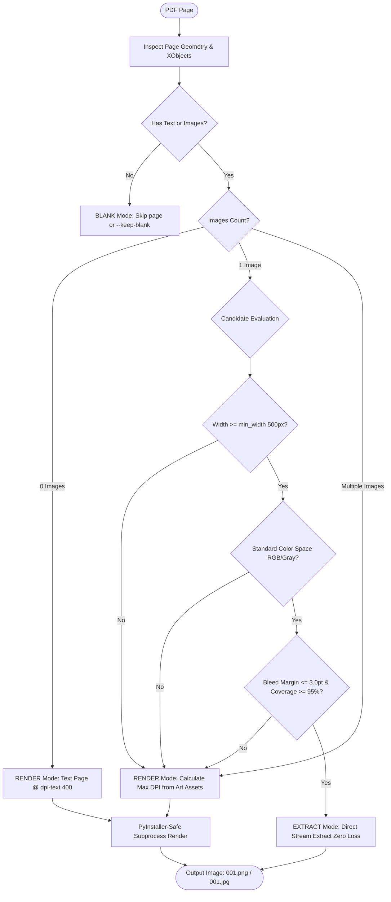

# PDF-Goon X

[](LICENSE)
[](https://www.python.org/)
[](tests/)
[](pyproject.toml)
[](https://github.com/astral-sh/ruff)

A Python CLI tool and library for extracting high-quality images from PDF files. It intelligently decides on a **per-page basis** whether to directly extract raw embedded images (zero quality loss) or render complex layouts, depending on page composition.

Available as both a **standalone Windows binary** (drag-and-drop ready) and a **pip-installable Python package**.

## Origin

Based on the original **PDF-Goon** by **Dnkz** (E-Hentai Forums):
> https://forums.e-hentai.org/index.php?showtopic=293338

PDF-Goon X is a modern, modular rewrite into a pip-installable Python package with type safety, robust test coverage, and standalone binaries.

## Why PDF-Goon X?

Existing PDF extraction approaches are typically designed around a single specialized strategy:

- **Raw stream extractors** (such as `pdfimages`) excel at extracting embedded images losslessly without re-encoding, but decompose complex pages with multiple illustrations, background elements, or overlapping text into separate image fragments.
- **Full-page renderers** (such as `pdftocairo`) preserve the complete visual composition and typography accurately, but re-render every page into a new raster image, introducing unnecessary re-encoding loss on pages that were originally a single full-resolution image.
- **Desktop utilities** provide interactive single-file inspection, but can be difficult to automate in high-throughput batch pipelines.

| Approach | Ideal Scenario | Trade-off on Mixed Layouts |
| :--- | :--- | :--- |
| **Raw Stream Extraction** (`pdfimages`, etc.) | Single full-bleed art pages (zero re-compression loss) | Separates mixed graphics into fragments; skips text-only pages |
| **Full Page Rendering** (`pdftocairo`, etc.) | Complex multi-asset layouts, vector graphics, typography | Re-encodes pages that already contain a single pristine image |
| **Manual Desktop Tools** | Visual inspection of individual files | Requires manual interaction; difficult to script in batch workflows |
| **PDF-Goon X (Hybrid)** | Mixed manga, artbooks, and scanned documents | **Best of both worlds**: Extracts standalone art losslessly, renders complex layouts dynamically |

PDF-Goon X bridges these strategies with **per-page intelligent decision-making**: it extracts the raw embedded stream whenever a page consists of a single full-bleed illustration, and automatically switches to precise full-page layout rendering whenever multiple assets, text, or margins are detected.

---

## 🧠 Decision Engine Workflow



---

## 🚀 Quick Start

### Option A: Standalone Windows Binaries (No Python Required)

Pre-built standalone executables are available in releases:
- **`pdf-goon.exe` (Release)**: Clean, silent automation CLI for terminal scripts and background workers.
- **`pdf-goon-debug.exe` (Debug / Internal Test)**: Tailored for non-technical team members and scanlation groups:
  - Supports **drag-and-drop** directly in Windows Explorer.
  - Automatically holds the console window open (`--pause`) so diagnostics never vanish.
  - Generates `pdf_goon_debug.log` with environment specs and per-page decisions.
  - Prints complete Python tracebacks on unexpected errors.

### Option B: Python Library & CLI

Requires **Python 3.11+**:

```bash
# Clone and install in editable mode
git clone https://github.com/libering/PDF-Goon-X.git
cd PDF-Goon-X
pip install -e .

# With test and dev dependencies
pip install -e ".[dev]"
```

---

## 💻 CLI Usage

```bash
# Process current directory
pdf-goon

# Process a specific file or folder
pdf-goon "D:\Manga\Volume_01.pdf"
pdf-goon "/path/to/archive_folder/"

# Verbose output (displays per-page EXTRACT vs RENDER decisions)
pdf-goon -v

# Move processed PDFs to system Recycle Bin or '!delete' folder
pdf-goon -r

# Recursively scan all subdirectories
pdf-goon -recursive

# Set fallback rendering DPI for text-only / novel pages (default: 400)
pdf-goon -dpi-text 600

# Set minimum width threshold for direct extraction (default: 500px)
pdf-goon -min-w 600

# Margin tolerance for full-page bleed detection (default: 3.0pt)
pdf-goon --margin-tolerance 4.0

# Render blank pages instead of skipping them
pdf-goon --keep-blank

# Write diagnostic logs to custom file
pdf-goon --log-file debug_trace.log

# Pause console before exiting (prevents terminal closing on Windows)
pdf-goon --pause

# Full diagnostic debug mode
pdf-goon --debug
```

### Options Reference

| Flag | Default | Description |
| :--- | :---: | :--- |
| `path` | `.` | Target PDF file or folder path |
| `-v`, `--verbose` | `off` | Print per-page EXTRACT vs RENDER decision telemetry |
| `-r`, `--replace` | `off` | Move processed PDFs to Recycle Bin / `!delete` folder |
| `-recursive` | `off` | Recursively process subfolders |
| `-dpi-text DPI` | `400` | Rendering DPI for pages without full-bleed art |
| `-min-w PX` | `500` | Minimum pixel width to qualify as full-page art |
| `--margin-tolerance PTS`| `3.0` | Maximum allowed boundary gap in points for bleed detection |
| `--keep-blank` | `off` | Render blank pages at `dpi_text` instead of skipping |
| `--no-optimization` | `off` | Skip lossless image post-compression (`pingo` / `oxipng`) |
| `--pause` | `off` | Prompt `Press Enter to exit` before termination |
| `--log-file [PATH]` | `None` | Stream dual diagnostic output to file (default: `pdf_goon_debug.log`) |
| `--debug` | `off` | Full diagnostic logs, environment dump, and stack traces |

---

## 🐍 Python API

```python
import pdf_goon

# Simple execution
results = pdf_goon.process("./manga_volumes")

# Advanced pipeline execution with progress telemetry
results = pdf_goon.process(
    path="./manga_volumes",
    verbose=True,
    replace=False,
    optimize=True,
    dpi_text=400,
    min_width=500,
    margin_tolerance=3.0,
    recursive=True,
    progress_callback=lambda cur, total, p: print(f"[{cur}/{total}] Processing: {p.name}"),
)

for res in results:
    if res.success:
        print(f"✓ {res.pdf_path.name}: {res.pages_processed} pages processed.")
    else:
        print(f"✗ {res.pdf_path.name}: Error - {res.error}")
```

---

## 🏗️ Architecture & Internals

```
pdf_goon/
├── __init__.py          # Public API: process(), make_config()
├── __main__.py          # Python module entrypoint: python -m pdf_goon
├── debug_entry.py       # Standalone debug executable entrypoint (auto-pause/log)
├── cli.py               # CLI parser, logging setup, error interception
├── core.py              # Batch coordinator, directory scanner, pipeline loop
├── analyze.py           # Page analyzer: metadata inspection, mode decision
├── geometry.py          # Geometric bounding box overlap, polygon union & bleed analysis
├── extract.py           # Direct extraction (pypdf) & isolated worker management
├── _render_worker.py    # Isolated process render worker (pypdfium2)
├── backends.py          # Abstract protocol interface for pluggable engines
├── files.py             # File system atomicity, collision avoidance, recycle bin
├── optimize.py          # Lossless optimizer runner (pingo / oxipng / jpegoptim)
├── tools.py             # Subprocess sandbox and tool discovery
└── models.py            # Strongly typed Dataclasses, Enums, and custom exceptions
```

### Core Pipeline Highlights
- **Sub-pixel Bleed Calculation (`geometry.py`)**: Uses geometric polygon union and area coverage computation. Pages with minor trimming margins ($\le 3.0$ pt) are safely identified as full-bleed, avoiding unnecessary rasterization.
- **Process Isolation**: Rendering tasks execute inside isolated worker processes (`_render_worker.py`), preventing native C++ memory fragmentation from Poppler / PDFium across large batches.
- **Atomic Collisions Safeguard**: Output file collisions are avoided via indexed naming buffers.

---

## 🧪 Verification & Testing

The codebase maintains strict quality guarantees:

```bash
# Run 205+ unit, integration, and property-based tests
pytest

# Property-based fuzzing (Hypothesis)
pytest tests/test_analyze_property.py tests/test_geometry_property.py

# Strict type checking (0 errors across all 32 source files)
mypy pdf_goon tests

# Code style and linting
ruff check pdf_goon tests
ruff format --check pdf_goon tests
```

---

## 📜 Acknowledgments

- Credits to the original **PDF-Goon** idea and implementation by **Dnkz** on [E-Hentai Forums](https://forums.e-hentai.org/index.php?showtopic=293338).
- Modernized and maintained by the open-source community into a type-safe, production-ready hybrid pipeline.
- Built on top of [pypdf](https://github.com/py-pdf/pypdf), [pypdfium2](https://github.com/pypdfium2-team/pypdfium2), and [Pillow](https://github.com/python-pillow/Pillow).

## 📄 License

[MIT License](LICENSE)
